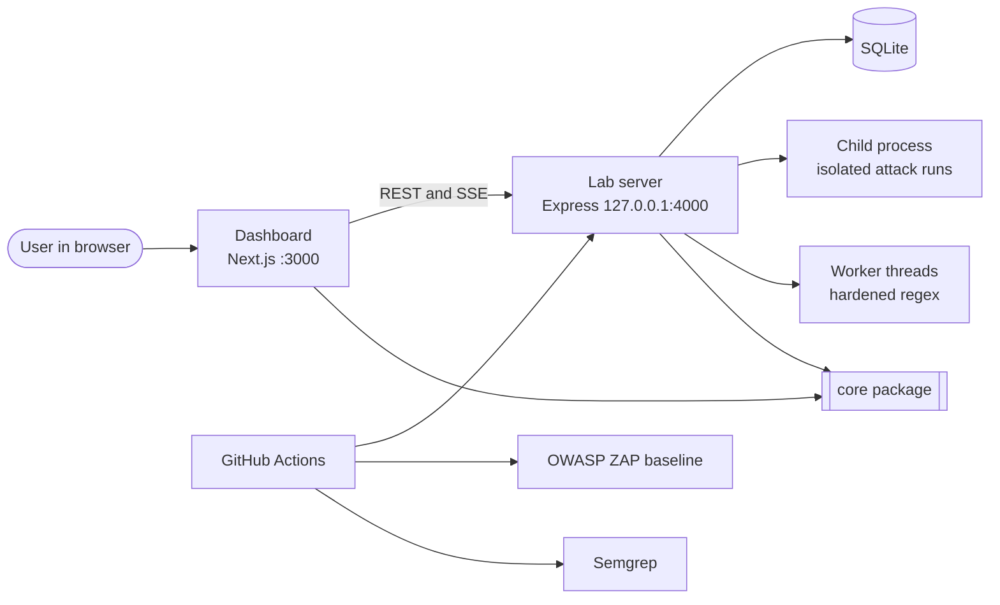
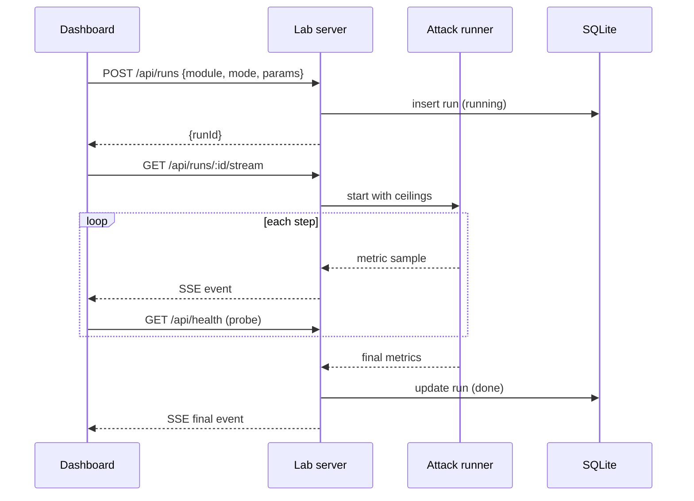

# Architecture and Technical Decisions

**Project:** Proofline
**Audience:** Engineers, security researchers, and evaluators
**Companion documents:** README.md, TRD.md, DesignBrief.md

---

## 1. System overview

Proofline has two runtime parts and one shared package.

- **Dashboard (`apps/web`).** Next.js app that starts runs, shows live traces and results, and exports evidence. It never contains vulnerable code.
- **Lab server (`apps/lab`).** Express server that contains both the vulnerable and the hardened implementation of each flaw, plus the attack runners and the database. It is the only place intentional vulnerabilities live.
- **Core package (`packages/core`).** Types shared by both apps, the CVSS v3.1 calculator and the findings catalogue.

### Context diagram



### Run lifecycle



### Module design pattern

Every module has the same shape, so a new vulnerability can be added without touching the dashboard shell.

```
apps/lab/src/modules/<module>/
  vulnerable.ts     the intentionally flawed implementation
  hardened.ts       the fixed implementation
  runner.ts         the attack runner (with ceilings)
  routes.ts         HTTP endpoints, picks implementation from `mode`
  meta.ts           title, CWE, OWASP category, CVSS vectors, copy for the dashboard
  <module>.test.ts  regression tests that read LAB_MODE
```

The dashboard reads `meta.ts` content through `GET /api/findings`, so module names and descriptions are written once.

---

## 2. Decision log

Each decision lists the choice, the reasons, and what was rejected.

### D1. TypeScript end to end

- **Choice:** TypeScript for the dashboard, the lab server and the shared package.
- **Why:** One language for the whole project, shared types for API contracts, and simple setup without polyglot overhead. ReDoS and prototype pollution are most naturally demonstrated in JavaScript, because the V8 regex engine backtracks and JavaScript objects have prototypes.
- **Rejected:** Python (Flask) backend. It would work for the race condition, but ReDoS and prototype pollution would need separate stacks.

### D2. Monorepo with pnpm workspaces

- **Choice:** `apps/web`, `apps/lab`, `packages/core` in one repository.
- **Why:** One clone, one install, one CI pipeline, and shared types without publishing a package.
- **Rejected:** Separate repositories (more setup overhead), Nx or Turborepo (extra tooling the project does not need).

### D3. Next.js App Router for the dashboard

- **Choice:** Next.js with the App Router, React Server Components for static content, client components for live charts.
- **Why:** Fast production build, simple routing, built-in font loading (`next/font`), and modern React ecosystem integration.
- **Rejected:** Vite SPA (fewer built-in features for fonts and routing), separate design framework (Tailwind with custom tokens is enough).

### D4. Express for the lab server, kept deliberately small

- **Choice:** Express with a handful of middleware, no ORM.
- **Why:** The vulnerable code must be easy to audit. Fewer layers means concise code listings and transparent control flow.
- **Rejected:** NestJS and Fastify (unnecessary abstraction that obscures vulnerability mechanisms).

### D5. Mode is chosen per request, never stored on the server

- **Choice:** Every call carries `mode: "vulnerable" | "hardened"`.
- **Why:** Paired runs, where both modes run at once, are the centre of the dashboard. Global server state would make them impossible and would make tests order-dependent.
- **Consequence:** The vulnerable and hardened implementations must live side by side and must not share mutable state, except through clearly separated tables.

### D6. SQLite through better-sqlite3

- **Choice:** One SQLite file, synchronous driver.
- **Why:** Zero setup, easy to reset, and straightforward to export as empirical evidence. The synchronous driver is fast enough for the lab and keeps code short.
- **Race condition detail:** better-sqlite3 calls are synchronous, so a pure check-then-write would never race in a single Node process. The vulnerable path therefore includes an awaited step between the check and the write (a call to a simulated ledger service with `RACE_GAP_MS` delay). That mirrors real code, where the gap is a network call, and it makes the race reproducible. The hardened path removes the gap by using one atomic SQL statement.
- **Rejected:** PostgreSQL (more setup, no benefit for the demonstration), in-memory only (loses the evidence history).

### D7. ReDoS: main thread when vulnerable, worker thread with timeout when hardened

- **Choice:** Vulnerable code runs the regex directly on the main thread. Hardened code applies three layers: input length cap, a linear-time rewrite of the pattern, and execution in a worker thread that is terminated after a timeout.
- **Why:** Running on the main thread is what makes the whole server stall, which is the real-world impact of ReDoS. The layered fix demonstrates defense in depth across multiple validation and runtime boundaries.
- **Safety:** Both modes share a ladder ceiling and a total time limit, enforced by the runner, so the demo cannot freeze a laptop.
- **Optional extra:** An RE2-based variant as a fourth layer, if the native module installs cleanly. It is not required.
- **Rejected:** Running the vulnerable regex in a worker as well. That would hide the availability impact the project wants to show.

### D8. Dependency flaw through npm aliases

- **Choice:** Install the same library twice, for example `"lodash-vulnerable": "npm:lodash@<vulnerable version>"` and `"lodash": "<current>"`.
- **Why:** The mode switch needs both versions available at runtime. Aliases give that without a second server.
- **Version selection:** The agent must pick a version that `npm audit` actually flags and that is exploitable through a deep merge (prototype pollution). Verify the advisory before committing, and record the advisory ID in `meta.ts`.
- **Isolation:** Attacks run in a child process so `Object.prototype` pollution cannot leak into the main server. This also makes tests order-independent.
- **Rejected:** Mocking the vulnerable package. Security evaluation demands real advisories and reproducible exploits.

### D9. CVSS calculator implemented in code

- **Choice:** Implement the CVSS v3.1 base formula in `packages/core` with unit tests.
- **Why:** It demonstrates transparent scoring logic directly from the CVSS v3.1 specification, avoids external dependencies, and updates dynamically with vector changes.
- **Verification:** Test against published example scores from the FIRST specification.

### D10. Regression tests as security assertions, run in both modes

- **Choice:** Tests assert the secure behaviour. `LAB_MODE=hardened` must pass. `LAB_MODE=vulnerable` must fail on the targeted assertions.
- **Why:** A test that only passes proves little. A test that fails before the fix and passes after proves the mitigation is effective (dual-mode regression testing).
- **Tooling:** `test:proof` inverts the exit code for the vulnerable run and checks that exactly the expected tests failed.

### D11. Live updates through Server-Sent Events

- **Choice:** SSE from the lab server to the dashboard.
- **Why:** One-way streaming is all that is needed, it works over plain HTTP, and it needs no extra library.
- **Rejected:** WebSockets (two-way channel not needed), polling only (charts feel less live).
- **Note:** During a ReDoS run on the vulnerable path the main thread is blocked, so SSE messages and probes will stall. That is part of the demonstration. The dashboard marks stalled intervals explicitly instead of hiding them.

### D12. Charts with Recharts, styled by design tokens

- **Choice:** Recharts, with custom axes, tooltips and colours taken from the design tokens.
- **Why:** Fast to build, accessible enough with extra labelling, and good enough once styled. A custom SVG chart is a stretch goal for the paired trace only.
- **Rejected:** Chart.js canvas (harder to style to the design brief and to export crisp vector images).

### D13. Security of the lab itself

- **Choice:** Loopback-only binding and request guard, per-run ceilings, no outbound network calls from attack runners, CORS limited to `http://localhost:3000`.
- **Why:** The project contains intentional vulnerabilities and must not become a real risk.
- **Docker:** Inside Docker the server binds to `0.0.0.0` only when `LAB_ALLOW_CONTAINER=1`, and the Compose file publishes ports on `127.0.0.1` only.

### D14. CI proves the flaws and the fixes

- **Choice:** GitHub Actions jobs: `quality` (lint, typecheck, unit), `proof` (hardened passes, vulnerable fails as expected), `semgrep`, `audit`, `zap`.
- **Why:** The pipeline demonstrates continuous security automation incorporating static analysis, dependency checking, and dynamic scanning.
- **Allow-list policy:** Intentional findings are suppressed only with an inline comment that names the module and the reason. A custom Semgrep rule pack detects each flaw pattern so the pipeline shows that the scanner finds them.

### D15. Light, editorial visual identity

- **Choice:** A light interface with a restrained palette and a high-contrast serif for display type. Details are in DesignBrief.md.
- **Why:** The project should look like a polished product from an established company, and the user asked to avoid the dark, cyan "hacker" look that most security tools use.

---

## 3. Key implementation notes

### 3.1 ReDoS module

- The vulnerable pattern is a classic nested quantifier. Keep it in one named constant with a comment explaining the backtracking so code listings and audits are self-explanatory.
- The ladder sends `"a".repeat(n) + "!"` style inputs that force worst-case backtracking. Keep `n` below the ceiling.
- Measure event-loop delay with `perf_hooks.monitorEventLoopDelay`.
- The rewrite in Hardened mode must accept the same valid inputs. Unit tests compare the two patterns on a set of valid and invalid samples that are short enough to be safe.

### 3.2 Race module

- Use a start barrier in the runner so all N requests are released together.
- Count outcomes by HTTP status and by final database state, not only by responses. The database state is the ground truth.
- Hardened path: one `UPDATE coupons SET uses = uses + 1 WHERE code = ? AND uses < max_uses`, check `changes === 1`, then insert into `redemptions` (unique constraint) inside a transaction. Idempotency keys return the original result for retries.

### 3.3 Dependency module

- The vulnerable endpoint deep-merges untrusted JSON into a settings object using the vulnerable alias.
- The profile endpoint builds a fresh object and reads `isAdmin` from it. Prototype pollution makes `isAdmin` appear true through inheritance.
- Hardened path: patched alias plus a key blocklist plus schema validation. Document that the schema is the stronger control and the library upgrade is defence in depth.
- Show the audit result next to the exploit result. The audit is the detection side, the exploit is the impact side.

### 3.4 Evidence

- Every run stores its raw samples. Charts can always be rebuilt from stored data.
- The export includes the git commit hash, Node version and operating system, so exported telemetry is reproducible and verifiable.

---

## 4. Directory and naming conventions

- Files: `kebab-case.ts`, React components `PascalCase.tsx`.
- API paths: lowercase, singular module prefix (`/api/redos/...`).
- Environment variables: `LAB_*` for the lab server, `NEXT_PUBLIC_*` only for the API base URL.
- Types shared across apps live in `packages/core/src/types`.
- No default exports except where Next.js requires them.

## 5. Configuration

| Variable | Default | Purpose |
| --- | --- | --- |
| `LAB_PORT` | 4000 | Lab server port |
| `LAB_ALLOW_CONTAINER` | unset | Allow non-loopback bind inside Docker |
| `REDOS_MAX_LADDER` | 28 | Highest repeat count allowed |
| `RUN_MAX_SECONDS` | 30 | Hard time limit per run |
| `RACE_GAP_MS` | 15 | Delay in the vulnerable path between check and write |
| `RACE_MAX_CONCURRENCY` | 50 | Highest parallel request count |
| `NEXT_PUBLIC_LAB_URL` | http://127.0.0.1:4000 | Base URL used by the dashboard |

## 6. Known limitations

- Timings depend on the machine. Benchmarks and evaluations should record hardware and Node version.
- The race condition depends on a simulated gap. Real systems have variable gaps, so the lab shows that the flaw exists, not how often it occurs in production.
- The dashboard has no authentication because it is a local lab.
- ZAP baseline is a passive scan and does not find every issue.
- The audit depends on the advisory database at the time of the run. The stored fixture keeps the demonstration working offline.

## 7. Architectural roadmap items

1. Evaluation of alternative concurrency models for high-throughput race testing.
2. Integration of the optional RE2 linear-time regex engine layer.
3. Expansion of dependency vulnerability profiles for additional prototype pollution vectors.
